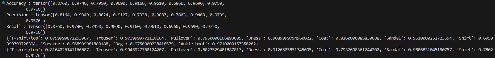

# AI-based Image Classifier & Music Recommender System

## Overview
This repository contains two AI-powered systems:

1. **AI Image Classifier**: A deep learning project designed to classify product images for e-commerce applications. Built with PyTorch, it leverages convolutional neural networks (CNNs) and the FashionMNIST dataset to demonstrate robust multiclass image classification.

2. **Personalized Music Recommender System**: A comprehensive music recommendation engine using Spotify's API that analyzes user listening history, song features, and artist popularity to recommend tracks that match user preferences.

## 🎵 Music Recommender System

### Features
- **User Data Analysis**: Analyzes listening history, top tracks, saved tracks, and recently played songs
- **Audio Feature Analysis**: Uses Spotify's audio features (danceability, energy, valence, etc.)
- **Artist Popularity Integration**: Considers artist popularity and genres
- **Multiple Recommendation Methods**:
  - Content-based filtering using audio features
  - Cluster-based recommendations using K-means clustering
  - Hybrid approach combining multiple methods
- **User Profile Generation**: Creates comprehensive music preference profiles

### Setup Instructions

1. **Install Dependencies**:
   ```bash
   pip install -r requirements.txt
   ```

2. **Set up Spotify API Credentials**:
   - Go to [Spotify Developer Dashboard](https://developer.spotify.com/dashboard/applications)
   - Create a new app
   - Copy your Client ID and Client Secret
   - Set up redirect URI (e.g., `http://localhost:8080/callback`)

3. **Configure Environment Variables**:
   ```bash
   cp .env.example .env
   # Edit .env with your Spotify credentials
   ```

4. **Run the System**:
   ```bash
   python music_recommender.py
   ```

### Usage Examples

```python
from music_recommender import MusicRecommenderSystem

# Initialize the system
recommender = MusicRecommenderSystem()

# Get hybrid recommendations (best approach)
recommendations = recommender.get_recommendations('hybrid', 10)

# Get user's music profile
profile = recommender.get_user_profile()

# Print results
recommender.print_recommendations(recommendations)
recommender.print_user_profile(profile)
```

### Recommendation Methods

1. **Content-Based Filtering**: Analyzes audio features to find similar tracks
2. **Cluster-Based Filtering**: Groups similar tracks and recommends from preferred clusters
3. **Hybrid Approach**: Combines both methods for optimal results

## 🖼️ Image Classifier

### Features
- Uses PyTorch and TorchMetrics for model development and evaluation
- Loads and preprocesses FashionMNIST dataset
- Defines a custom CNN architecture
- Trains the model for multiclass classification
- Evaluates accuracy, precision, and recall (overall and per class)

### Model Architecture
- **Feature Extractor:**
  - 2 convolutional layers (32 and 64 filters)
  - ELU activation
  - Max pooling
  - Flatten layer
- **Classifier:**
  - Fully connected layer for 10 classes

### Usage
```bash
python aiimageclassifier.py
```

## Installation

1. Clone the repository:
   ```bash
   git clone https://github.com/ShafqaatMalik/ai-image-classifier.git
   cd ai-image-classifier
   ```

2. Install dependencies:
   ```bash
   pip install -r requirements.txt
   ```

3. For Music Recommender, set up Spotify API credentials (see above)

## Requirements
- Python 3.8+
- PyTorch
- Spotify API credentials (for music recommender)
- See `requirements.txt` for full list

## Results
### Image Classifier
The notebook prints overall and per-class accuracy, precision, and recall after model evaluation.


### Music Recommender
The system provides personalized music recommendations based on your Spotify listening history and preferences, with detailed user profiles and multiple recommendation strategies.
